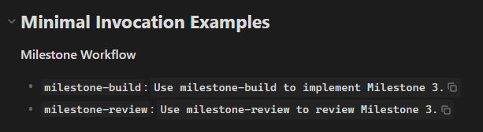

# Selective Inline Copy



Add a copy button to selected inline code in Obsidian.

## Usage

Start an inline code span with `[copy]` followed by a space:

```markdown
`[copy] npm install`
```

In reading view, the marker is hidden and the copy button copies `npm install`. Other inline code and fenced code blocks are unchanged.

## Installation

Download `main.js`, `manifest.json`, and `styles.css` from a published release and put them in your vault's `.obsidian/plugins/selective-inline-copy/` folder. Reload Obsidian, then enable **Selective Inline Copy** under **Settings → Community plugins**.

To build from source instead, run `npm install` and `npm run build`, then copy the same three files to that folder.

## Releases

In a clean working tree, run `npm version patch` (or `minor` or `major`) to update the version files and create a commit and tag. Push the commit and the matching tag, such as `1.0.1` (without a `v` prefix). The release workflow builds and publishes `main.js`, `manifest.json`, and `styles.css`. Alternatively, run **Release Obsidian plugin** from **Actions** with an existing tag that has no release.

## License

MIT. This project is based on the [Obsidian sample plugin](https://github.com/obsidianmd/obsidian-sample-plugin); its original license notice is in [NOTICE](NOTICE).